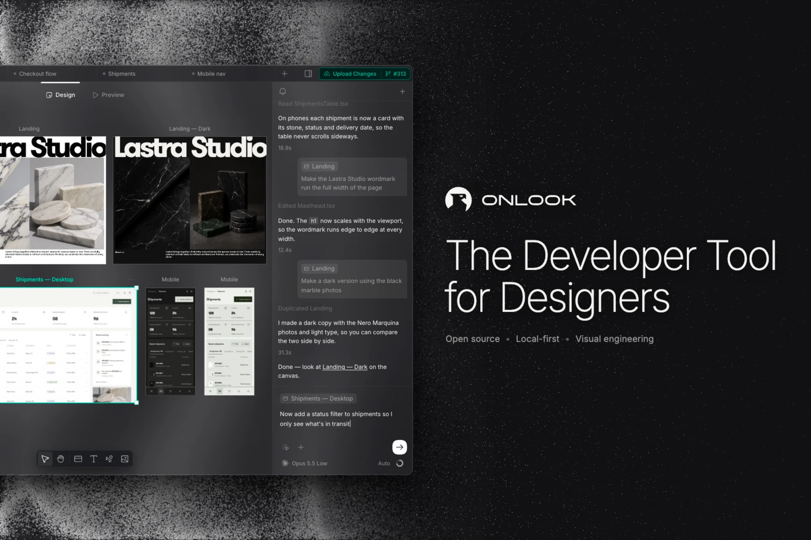

<h3 align="center">Onlook</h3>
  

    <strong>The developer tool for Designers</strong>
     
    Onlook is a free, local-first editor where designers craft exceptional experiences in code
     
     
    <a href="https://www.onlook.com/install?utm_source=github&utm_medium=readme"><strong>→ Download today </strong></a>
  

  

    👨‍💻👩‍💻👨‍💻
    <a href="https://www.ycombinator.com/companies/onlook/jobs/">We're hiring engineers and designers in SF!</a>
    👩‍💻👨‍💻👩‍💻
  

[![Discord][discord-shield]][discord-url]
[![LinkedIn][linkedin-shield]][linkedin-url]
[![X / Twitter][twitter-shield]][twitter-url]
[![YouTube][youtube-shield]][youtube-url]
[![Substack][substack-shield]][substack-url]

[中文](https://www.readme-i18n.com/onlook-dev/onlook?lang=zh) |
[Español](https://www.readme-i18n.com/onlook-dev/onlook?lang=es) |
[Deutsch](https://www.readme-i18n.com/onlook-dev/onlook?lang=de) |
[français](https://www.readme-i18n.com/onlook-dev/onlook?lang=fr) |
[Português](https://www.readme-i18n.com/onlook-dev/onlook?lang=pt) |
[Русский](https://www.readme-i18n.com/onlook-dev/onlook?lang=ru) |
[日本語](https://www.readme-i18n.com/onlook-dev/onlook?lang=ja) |
[한국어](https://www.readme-i18n.com/onlook-dev/onlook?lang=ko)

# An Open-Source, Visual-First Canvas for Code

Craft websites, prototypes, and designs with AI on a canvas built for creative work. See
your real app running live, shape it visually, and let your own agent write the code. An
open-source alternative to Figma, V0, Replit Agent, Base 44, Webflow, etc.

## Why Onlook

- 🎨 **Built for design.** Onlook is the open-source developer tool for designers. You see your real app running live on a canvas, explore ideas side by side, and shape the interface visually instead of from a terminal. Design apps, websites, posters, graphics, and more with your local fonts and assets. 
- 🤖 **Bring your own agent.** We don't ship our own model. Connect the Claude Code or ChatGPT/Codex account you already have, and that agent does the work inside your project. Plug in more tools through MCP connectors to bring all of the context you need to your creative workflow. Work on multiple design tasks at once across repos and pages.
- 📁 **Works on your real repo.** Onlook opens any Git repository on your machine and runs your own dev server, so what you design is your actual product, not a mockup that someone has to rebuild later.
- 🖥️ **A desktop app, local-first.** Onlook runs on your computer. Your code stays on your computer, and the source build needs no Onlook account, cloud keys, or `.env` file.
- 📤 **Share what you make.** Export artifacts as self-contained HTML, PNG, JPEG, or PDF to hand off, review, or post.
- 🧡 **Open source.** Apache 2.0. Read it, fork it, and customize it yourself (we'd love to hear how you customize it!)

## What you can do with Onlook

- [x] Design on your real codebase
  - [x] Live app on an infinite canvas
  - [x] Mobile, tablet, and desktop frames side by side
  - [x] Safe worktree copy, so your folder is never touched
  - [x] Parallel projects as tabs
- [x] Design with your own agent
  - [x] Bring your own Claude Code or ChatGPT/Codex plan
  - [x] Ask about any element on the canvas
  - [x] Agent arranges the canvas for you (variations, states, flows)
  - [x] Reference images on the canvas
- [x] Sketch and share
  - [x] Artifacts for quick HTML sketches outside your repo
  - [x] Export to HTML, PDF, PNG, and JPEG
- [x] Ship it
  - [x] Import a GitHub repo
  - [x] Start entirely new codebases from scratch
  - [x] One-press pull requests, from checks to merge

## Getting Started
🖥️ [Download the Desktop App](https://www.onlook.com/install) (Recommended) – The fastest way to get started with Onlook.

* macOS (Apple Silicon · Intel x64) → [Download](https://www.onlook.com/install)
* Windows – Coming soon. Join the [Windows waitlist here](https://www.onlook.com/waitlist?os=windows) and be emailed when we have updates.
* Linux – No Linux artifact is published and we're still gauging demand for Linux. Join the [Linux waitlist here](https://www.onlook.com/waitlist?os=linux) and be emailed when we have updates. 

🧑‍💻 Build from source – [SOURCE_BUILD.md](SOURCE_BUILD.md) covers building and running Onlook on a Mac. No Onlook account or cloud keys needed.

## How it works

1. **Open a project.** Point Onlook at any Git repository on your computer, or import one. Your code stays where it is.
2. **Onlook runs your app.** It starts your own dev server locally, the same way you would from a terminal.
3. **See it live on a canvas.** Your running app appears in frames on an open canvas, so you can look at pages, sizes, and ideas side by side.
4. **Design with your agent.** Describe what you want in chat. Onlook hands the request to the Claude Code or ChatGPT/Codex account you connected, and that agent edits the real files in your repo.
5. **Watch it update.** Changes show up on the canvas as your dev server reloads, and Git keeps track of everything that changed.
6. **Share the result.** Export artifacts as self-contained HTML, PNG, JPEG, or PDF.

Because Onlook runs your project with its own tooling, it works with all web frameworks or languages your dev server already supports.

## An example workflow

1. Start a new empty project by clicking the "New Draft" button in the upper left corner of the projects page.
2. Use the input box in the lower right corner of the screen to write what you'd like to be designed in Onlook.
3. Answer clarifying questions from the agent, and wait for it to build
4. Click to select individual frames for context in follow-up prompts, or double-click on a specific element to use the inline chat and guide the AI to edit that specific element.
5. Prompt more ideas on one or multiple designs until you're ready to share your work with a colleague.
6. Select the frame you'd like to share, and ask the agent to convert it into an Artifact for exporting.
7. Export the artifact as HTML/CSS or as a PNG using the export button in the upper right corner of the frame. 
8. Paste the exported artifact in Slack, email, or any messaging tool. 

## Our Tech Stack

| Layer | Stack |
|---|---|
| Desktop | [Electron](https://www.electronjs.org/) · [React 19](https://react.dev/) · [Astryx](https://astryx.atmeta.com/) (Design system)· [React Flow](https://reactflow.dev/) · [Zustand](https://zustand.docs.pmnd.rs/) · [CodeMirror](https://codemirror.net/) |
| Your project | [Git](https://git-scm.com/) for working directly on your repo · [node-pty](https://github.com/microsoft/node-pty) for running your dev server and shells |
| Tooling | [Bun](https://bun.sh/) · [Turborepo](https://turbo.build/) · usage analytics (see [Usage data](#usage-data)) |
| Export | HTML · PNG & JPEG ([Electron capturePage](https://www.electronjs.org/docs/latest/api/web-contents#contentscapturepagerect-opts)) · PDF ([Electron printToPDF](https://www.electronjs.org/docs/latest/api/web-contents#contentsprinttopdfoptions)) & [pdf-lib](https://pdf-lib.js.org/) |

## Contributing

If you have a suggestion that would make this better, please fork the repo and
create a pull request. You can also browse [open issues](https://github.com/onlook-dev/onlook/issues).

See the [CONTRIBUTING.md](CONTRIBUTING.md) for instructions and code of conduct.

To report a security issue, follow [SECURITY.md](SECURITY.md) instead of opening a public issue.

#### Contributors

## Contact

- Contact us: [Discord](https://discord.gg/hERDfFZCsH) - [Email](mailto:contact@onlook.com)
- Updates: [Twitter](https://twitter.com/onlookdev) - [LinkedIn](https://www.linkedin.com/company/onlook/) - [YouTube](https://youtube.com/@onlookdev) - [Substack](https://onlook.substack.com/)
- Project: [https://github.com/onlook-dev/onlook](https://github.com/onlook-dev/onlook)
- Website: [https://onlook.com](https://onlook.com/?utm_source=github&utm_medium=readme&utm_campaign=github)

## Looking for the previous version of Onlook?

- **Onlook v1 (web):** the browser-based version lives on the
  [`v1` branch](https://github.com/onlook-dev/onlook/tree/v1) of this repository.
- **Onlook Desktop (Electron, original):** the first desktop version is at
  [onlook-dev/desktop](https://github.com/onlook-dev/desktop).

## Usage data

Onlook collects product usage analytics to help us improve the app. In the official download they are on by default; a build from source asks first. You can turn them off in Settings, or set `STUDIO_TELEMETRY=0` to run or build without them. See the [privacy policy](https://www.onlook.com/privacy-policy) for details.

## License

Onlook's source code is distributed under the Apache 2.0 License. See
[LICENSE](LICENSE) for details.

The license covers source code, not every asset in this repository. Onlook's
icons come from [Central Icons](https://iconists.co/central) by Iconists. They
are licensed to Onlook for its own product, and that license does not extend to
forks. Onlook's brand marks, DMG art, and sounds aren't covered either. See
[ASSETS.md](ASSETS.md) for what's covered and what to replace if you fork, and
[NOTICE](NOTICE) for third-party notices.

<!-- https://www.markdownguide.org/basic-syntax/#reference-style-links -->

[linkedin-shield]: https://img.shields.io/badge/-LinkedIn-0A66C2?style=flat-square&logo=
[linkedin-url]: https://www.linkedin.com/company/onlook
[twitter-shield]: https://img.shields.io/badge/-X-000000?style=flat-square&logo=x&logoColor=white
[twitter-url]: https://x.com/onlookdev
[discord-shield]: https://img.shields.io/badge/-Discord-black?style=flat-square&logo=discord&logoColor=white&color=5865F2
[discord-url]: https://discord.gg/hERDfFZCsH
[youtube-shield]: https://img.shields.io/badge/-YouTube-black?style=flat-square&logo=youtube&logoColor=white&color=FF0000
[youtube-url]: https://www.youtube.com/@onlookdev
[substack-shield]: https://img.shields.io/badge/-Substack-black?style=flat-square&logo=substack&logoColor=white&color=FF6719
[substack-url]: https://onlook.substack.com
